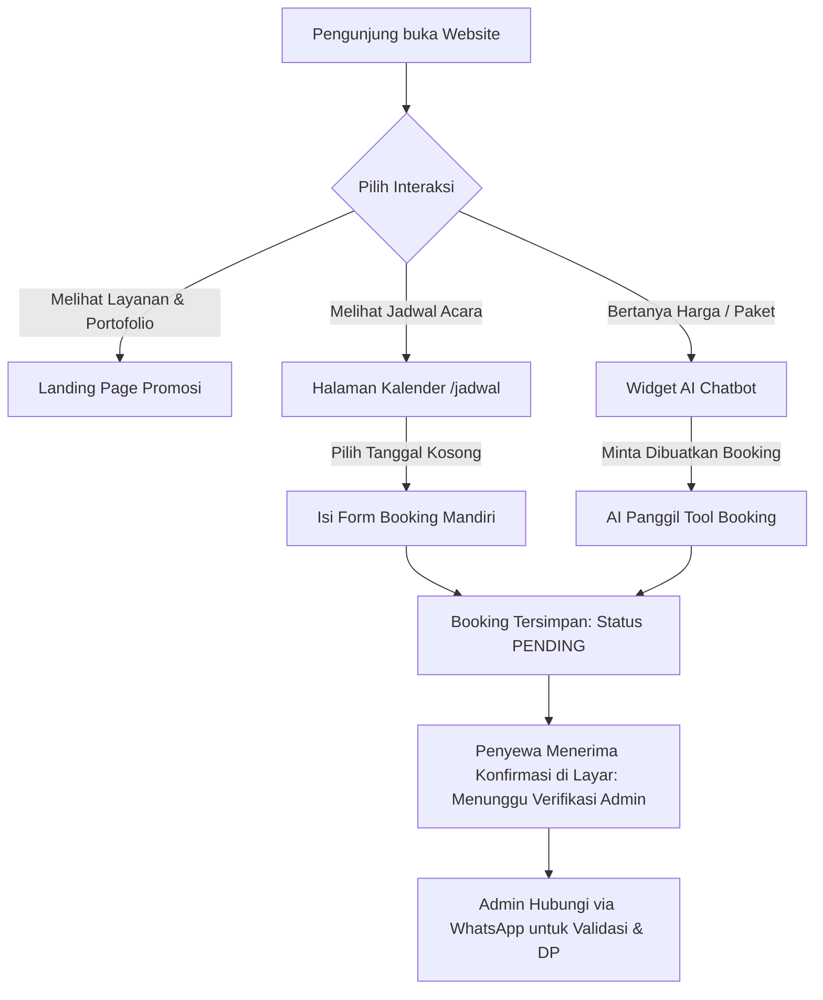
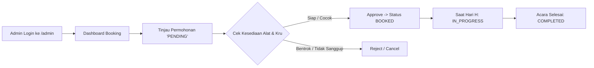
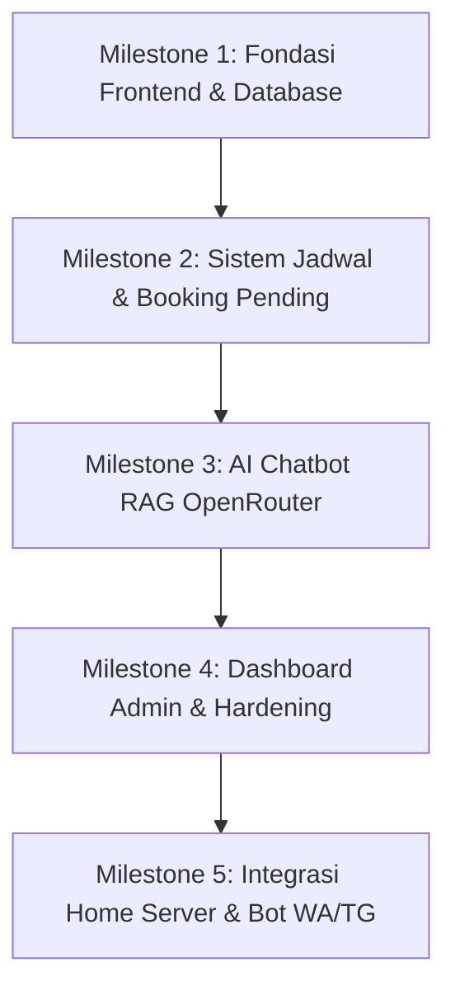

# Product Requirements Document (PRD) — Sigma Music Platform v2

> Status: **Draft Disetujui untuk Eksekusi**  
> Tanggal: 2026-11-23 · Target Domain: `sigmamusic.my.id` (atau domain produksi baru)  
> Repository: `github.com/AlephSc/sigma-music`  
> Author: Aleph & Assistant (berdasarkan skill `web-app-building`)

---

## 1. Ringkasan Produk (Overview)

Sigma Music Platform v2 adalah evolusi dari landing page promosi statis Sigma Music (jasa persewaan sound system, lighting, panggung, tenda, dekorasi, dan perlengkapan pesta di Jombang) menjadi aplikasi web interaktif yang dilengkapi:
1. **Pusat Promosi & SEO Lokal**: Mempertahankan konversi traffic lokal Jombang dan sekitarnya dengan performa tinggi.
2. **Jadwal & Kalender Ketersediaan**: Memberikan visibilitas tanggal kosong/terisi kepada calon penyewa secara transparan.
3. **AI Chatbot Konsultasi (RAG)**: Agen cerdas berbasis model gratis (OpenRouter Auto + Embedding terdedikasi) untuk menjawab pertanyaan seputar paket, estimasi, dan syarat sewa tanpa halusinasi, serta membantu mengajukan booking awal.
4. **Panel Operasional Admin**: Manajemen persetujuan status booking (`pending → booked → in_progress → completed`).
5. **Arsitektur Ekstensibel**: Fondasi yang siap terhubung dengan bot WhatsApp/Telegram dan replikasi data ke Home Server lokal pemilik tanpa memerlukan IP publik.

Seluruh sistem dirancang berjalan di atas **100% Free Tier** tanpa kartu kredit wajib.

---

## 2. Latar Belakang & Masalah (Background & Problem)

- **Masalah Saat Ini**:
  - Calon penyewa harus menanyakan secara manual ketersediaan tanggal acara lewat WhatsApp satu per satu.
  - Pemilik sering menjawab pertanyaan yang sama berulang kali (rincian paket alat, harga dasar, kapasitas genset/sound).
  - Pencatatan jadwal manual rentan risiko bentrok acara (double-booking) jika beberapa calon penyewa menanyakan tanggal yang sama di waktu bersamaan.
  - Keterbatasan waktu pemilik dalam membalas chat calon penyewa di jam-jam sibuk.

- **Solusi**:
  - Website mandiri yang menampilkan kalender ketersediaan interaktif.
  - AI Assistant terlatih (RAG) yang siap menjawab 24/7 dan mencatat draf booking (`pending`) untuk diverifikasi pemilik.
  - Notifikasi dan integrasi mendatang ke perangkat lokal (Home Server) untuk kendali penuh data di tangan pemilik.

---

## 3. Tujuan & Tolok Ukur Keberhasilan (Goals & Measurable Success)

1. **Efisiensi Tanya Jawab**: AI Chatbot mampu menangani >70% pertanyaan awal pengunjung (paket, area layanan, spesifikasi alat) dengan akurat sesuai dokumen rujukan.
2. **Pencegahan Salah Jadwal**: Tidak ada komitmen jadwal otomatis oleh AI. AI hanya membuat status `pending`; kepastian status `booked` mutlak di tangan admin.
3. **Performa & SEO**: Skor Lighthouse Performance & SEO pada landing page tetap ≥ 95, mempertahankan ranking Google Maps/Lokal Jombang.
4. **Nol Biaya Rutin (Zero-Cost Infrastructure)**: Sistem berjalan stabil pada kombinasi Free Tier (Vercel/Netlify, Cloudflare Workers, Neon Database, OpenRouter Free Tier).

---

## 4. Pengguna Sasaran & Batasan Sistem (Target Users & Constraints)

### Pengguna Sasaran
- **Pengunjung / Calon Penyewa**: Warga atau event organizer di Jombang dan sekitarnya yang mengakses lewat ponsel (mobile-first, ~85% traffic) atau desktop.
- **Admin / Pemilik Sigma Music**: Mengelola jadwal acara, mengonfirmasi booking, memantau log percakapan AI, dan mengelola dokumen RAG.

### Batasan Sistem (Constraints)
- **Anggaran**: Biaya server $0/bulan (memaksimalkan kuota gratis resmi).
- **Kapasitas Event Dinamis**: Kapasitas acara per hari bersifat fleksibel (bergantung skala acara: sound kecil vs hajatan besar). Sistem tidak memblokir tanggal secara kaku satu acara, melainkan menandai status dan memberi peringatan pada admin.
- **Konektivitas Home Server**: Home server pemilik berada di jaringan rumah (NAT/CGNAT) tanpa IP publik statis.

---

## 5. Fitur & Prioritas (User Stories & Priorities)

### P0 — Minimum Viable Product (Rilis Awal Inti)

#### 5.1. Landing Page Promosi & SEO (Porting 1:1)
- **Sebagai** calon penyewa, **saya ingin** melihat katalog layanan, galeri foto alat, area layanan Jombang, testimoni, dan FAQ, **sehingga** saya yakin menyewa di Sigma Music.
- *Kriteria Penerimaan (Acceptance Criteria)*:
  - Desain bertema Ultraviolet (lavender/dark aesthetic) dari versi v1 terpasang rapi dan responsif.
  - Meta tags, Open Graph, Twitter Cards, dan Schema.org (`LocalBusiness`, `FAQPage`) aktif.
  - Tombol CTA langsung menuju WhatsApp `0858-1668-6900` tetap tersedia sebagai kanal cepat.

#### 5.2. Kalender Jadwal Publik
- **Sebagai** calon penyewa, **saya ingin** melihat tanggal mana saja yang sudah ada acara dan tanggal yang masih terbuka, **sehingga** saya dapat merencanakan acara tanpa menunggu balasan chat.
- *Kriteria Penerimaan*:
  - Tampilan kalender bulan menampilkan status tanggal (Misal: Kosong / Ada Agenda / Penuh).
  - Privasi terjaga: Tidak ada nama, nomor telepon, atau data pribadi penyewa lain yang terekspos di API publik kalender (`GET /v1/availability`).
  - Klik pada tanggal terbuka membuka form pengajuan booking.

#### 5.3. Form Pengajuan Booking Mandiri
- **Sebagai** calon penyewa, **saya ingin** mengajukan reservasi tanggal secara langsung melalui web, **sehingga** jadwal acara saya tercatat dalam antrean.
- *Kriteria Penerimaan*:
  - Field: Nama, Nomor WhatsApp, Tanggal Acara, Jenis Acara/Paket, Alamat Acara, dan Catatan.
  - Validasi ketat nomor telepon (format standar Indonesia/62).
  - Status tersimpan sebagai `pending` di database; pengunjung menerima notifikasi layar bahwa reservasi akan dikonfirmasi pemilik lewat WhatsApp.
  - Proteksi anti-spam: Honeypot field dan rate limiting IP.

#### 5.4. AI Chatbot Tanya Jawab Berbasis RAG
- **Sebagai** pengunjung, **saya ingin** bertanya mengenai rincian paket, estimasi kebutuhan sound, area jangkauan, dan ketersediaan tanggal kepada AI, **sehingga** saya mendapat jawaban instan 24/7.
- *Kriteria Penerimaan*:
  - Chatbot terpasang sebagai floating widget di web (responsive bottom-sheet di mobile).
  - Menggunakan API **OpenRouter** dengan model otomatis (`openrouter/auto` atau free router fallback) dan embedding via **Gemini Embedding** atau **Cloudflare Workers AI**.
  - RAG Grounding: Jawaban hanya bersumber dari dokumen resmi Sigma Music. Jika informasi tidak ada di dokumen, AI menolak halus dan menyarankan menghubungi WhatsApp admin.
  - Tool Integration: AI dibekali fungsi `check_availability(date)` dan `create_booking_request(...)` (hanya status `pending`).
  - Tidak menampilkan data rahasia/PII pelanggan lain saat memeriksa ketersediaan tanggal.

#### 5.5. Panel Admin Operasional
- **Sebagai** pemilik Sigma Music, **saya ingin** melihat daftar permohonan sewa, menyetujui (`approve`), menolak, atau mengubah status acara, **sehingga** jadwal acara terkelola dengan rapi.
- *Kriteria Penerimaan*:
  - Autentikasi aman (Login email/password atau secure session).
  - Tabel booking dengan filter status: `pending`, `booked`, `in_progress`, `completed`, `cancelled`.
  - Tombol aksi: Konfirmasi Booking (ubah ke `booked`), Selesai, atau Batal.
  - Tampilan visual peringatan jika terdapat lebih dari satu acara di tanggal yang sama agar admin dapat memutuskan kelayakan alat/kru.

---

### P1 — Peningkatan & Manajemen Konten

#### 5.6. Manajemen Dokumen Pengetahuan AI (Knowledge Ingestion)
- **Sebagai** admin, **saya ingin** memperbarui daftar harga atau aturan sewa di web, **sehingga** AI langsung menggunakan data terbaru tanpa perlu mengubah kode sumber.
- *Kriteria Penerimaan*:
  - Fitur upload/input teks panduan (FAQ, katalog alat, ketentuan DP/pelunasan) di panel admin.
  - Dokumen otomatis di-chunk dan di-vektorisasi ke tabel pgvector di Neon DB.

#### 5.7. Pengaturan Kapasitas Fleksibel
- **Sebagai** admin, **saya ingin** menandai tanggal tertentu sebagai "Tutup/Penuh Total" secara manual jika kru sedang libur atau alat dalam perbaikan.

---

### P2 — Ekstensi Lanjutan & Otomasi Rumah (Home Server)

#### 5.8. Integrasi Notifikasi Bot WhatsApp / Telegram (Home Server)
- **Sebagai** pemilik, **saya ingin** menerima notifikasi instan di WhatsApp/Telegram pribadi ketika ada booking baru masuk, **sehingga** saya bisa langsung merespons.
- *Kriteria Penerimaan*:
  - Cloudflare Worker mengirimkan webhook saat ada booking baru berstatus `pending`.
  - Bot dijalankan di Home Server lokal. Koneksi menerima webhook masuk via **Cloudflare Tunnel** (`cloudflared`) gratis dan aman tanpa membuka port router / tanpa IP publik.

#### 5.9. Redundansi Data ke Home Server Lokal
- **Sebagai** pemilik, **saya ingin** salinan data booking dan jadwal tersimpan aman di harddisk home server saya, **sehingga** data tetap aman meski layanan cloud gratis mengalami downtime.
- *Kriteria Penerimaan*:
  - Skrip terjadwal (cron job) di home server yang menarik (pull) perubahan data terbaru dari Neon DB melalui secure connection.

---

## 6. Persyaratan Non-Fungsional (Non-Functional Requirements)

1. **Keamanan & Privasi**:
   - PII pelanggan (nama, nomor telepon, alamat) tidak boleh ditampilkan di endpoint publik manapun.
   - Endpoint admin wajib terlindungi token autentikasi (JWT / Session token).
   - Rate limit ketat pada endpoint `/v1/chat` (maks. 15 pesan/menit per IP) dan `/v1/bookings` (maks. 3 per jam per IP) via Cloudflare Worker.
2. **Ketersediaan & Keandalan**:
   - Backend Cloudflare Worker mendeteksi status Neon DB. Neon Serverless memiliki waktu *wake up* singkat setelah idle; worker menangani latency cold-start dengan timeout yang wajar (graceful retry).
3. **Aksesibilitas & UI**:
   - Mobile-first responsif (dukungan penuh layar 360px hingga desktop 4K).
   - Aksesibilitas navigasi keyboard dan atribut ARIA untuk komponen kalender dan chat widget.

---

## 7. Platform & Arsitektur Teknologi (Tech Stack)

| Komponen | Pilihan Teknologi | Peran & Alasan |
|---|---|---|
| **Frontend** | Next.js (App Router, React, Tailwind CSS) | Hosted di **Vercel** atau **Netlify** (Free Hobby Tier). Menyajikan SSR/SSG untuk SEO optimal dan UI interaktif. |
| **Backend API** | Cloudflare Workers (Hono framework + Zod) | Gratis 100.000 req/hari, edge deployment latensi rendah di Indonesia, validasi tipe data ketat. |
| **Database & Vector** | **Neon Postgres** (Serverless) + ekstensi `pgvector` | Free tier Postgres cepat, mendukung penyimpanan relasional booking sekaligus vektor embedding RAG. |
| **AI LLM Engine** | **OpenRouter API** (`openrouter/auto` / Free tier models) | Model cerdas gratis untuk penalaran dialog tanya jawab dan function calling booking. |
| **Embedding Engine** | **Gemini Embedding** (Google AI Studio) / **Cloudflare Workers AI** | Membuat representasi vektor 768-dimensi dari dokumen pengetahuan tanpa biaya. |
| **Home Server Bridge** | **Cloudflare Tunnel** (`cloudflared`) / Outbound Cron Pull | Menghubungkan bot lokal & sinkronisasi data tanpa perlu IP publik atau port forwarding di router rumah. |

---

## 8. Alur Pengguna & Gambaran UI (UI/UX Flow)

### 8.1. Alur Calon Penyewa

### 8.2. Alur Kerja Admin

---

## 9. Penanganan Kasus Batas (Edge Cases & Error Handling)

1. **Permintaan Jadwal Bertabrakan (Multiple Pending di Tanggal Sama)**:
   - Karena kapasitas fleksibel, sistem mengizinkan input beberapa status `pending` di tanggal yang sama.
   - Pada dashboard admin, tanggal tersebut diberi badge penanda: *"Ada 2 permohonan di tanggal ini"*. Admin yang memutuskan apakah alat mencukupi untuk keduanya atau harus memilih salah satu.
2. **Keterbatasan / Downtime Model Gratis OpenRouter**:
   - Jika endpoint model gratis OpenRouter mengalami rate-limit (HTTP 429) atau timeout, backend otomatis beralih (*fallback*) ke model alternatif gratis atau mengembalikan pesan ramah: *"Sistem AI sedang padat, silakan langsung hubungi WhatsApp kami di 0858-1668-6900"*.
3. **Pertanyaan di Luar Topik Rental (Out of Domain)**:
   - System prompt membatasi AI hanya menjawab seputar Sigma Music dan persewaan alat pesta. Pertanyaan coding, politik, atau umum akan dijawab secara sopan bahwa AI hanya melayani informasi rental.
4. **Neon Database Cold Start**:
   - Koneksi serverless Neon yang sedang idle bisa memerlukan 1-2 detik untuk bangun (*wake-up*). Driver database di Worker dilengkapi mekanisme *retry* agar request pengunjung tidak gagal.

---

## 10. Di Luar Cakupan (Out of Scope)

Fitur berikut **tidak dimasukkan** ke dalam rilis v2 (MVP) untuk menjaga keringkasan dan kestabilan:
- Sistem pembayaran online otomatis / Payment Gateway (pembayaran DP dan pelunasan tetap dilakukan manual via transfer rekening bank pemilik).
- Pelacakan armada/truk via GPS.
- Multi-user role kompleks (cukup satu akun pemilik/admin).
- Pembuatan faktur/invoice otomatis berformat PDF (akan dipertimbangkan di v3).

---

## 11. Peta Rilis & Urutan Dependensi (Roadmap)

- **Milestone 1: Fondasi Frontend & Database**
  - Setup repository Next.js 16 di `web/` (porting komponen & tema landing page v1).
  - Provisioning Neon Postgres & aktivasi ekstensi `pgvector`.
  - Deployment awal frontend ke Vercel / Netlify.
- **Milestone 2: Sistem Jadwal & Form Booking (P0)**
  - Backend Cloudflare Worker (`worker/`) dengan Hono API.
  - Endpoint `/v1/availability` dan `/v1/bookings`.
  - Halaman Kalender interaktif di `/jadwal` terhubung ke Worker & Neon.
- **Milestone 3: AI Chatbot RAG (P0)**
  - Pipeline RAG di Worker: Dokumen pengetahuan Sigma Music + Vector Embedding.
  - Integrasi OpenRouter Auto + Tool calling (`check_availability`, `create_booking_request`).
  - Widget chat UI di frontend.
- **Milestone 4: Dashboard Admin & Hardening (P1)**
  - Halaman `/admin` dengan autentikasi aman.
  - Manajemen status pesanan & viewer log chat.
  - Audit rate-limiting dan proteksi edge.
- **Milestone 5: Integrasi Home Server & Bot WA/Telegram (P2)**
  - Konfigurasi Cloudflare Tunnel di home server lokal.
  - Webhook dispatch dari Worker ke home server untuk notifikasi otomatis.
  - Skrip backup sinkronisasi lokal.

---

> **Daftar Asumsi:**
> 1. *Asumsi:* Hostname domain produksi adalah `sigmamusic.my.id` atau domain gratisan `*.vercel.app` / `*.netlify.app` sebelum domain utama diarahkan.
> 2. *Asumsi:* Dokumen rujukan RAG tahap 1 akan dibuatkan drafnya mencakup paket Sound System 1000W-5000W, Paket Tenda Pernikahan/Khitanan, dan Layanan Service/Las.
> 3. *Asumsi:* Admin mengakses dashboard melalui browser modern dengan otentikasi kunci sandi (password).